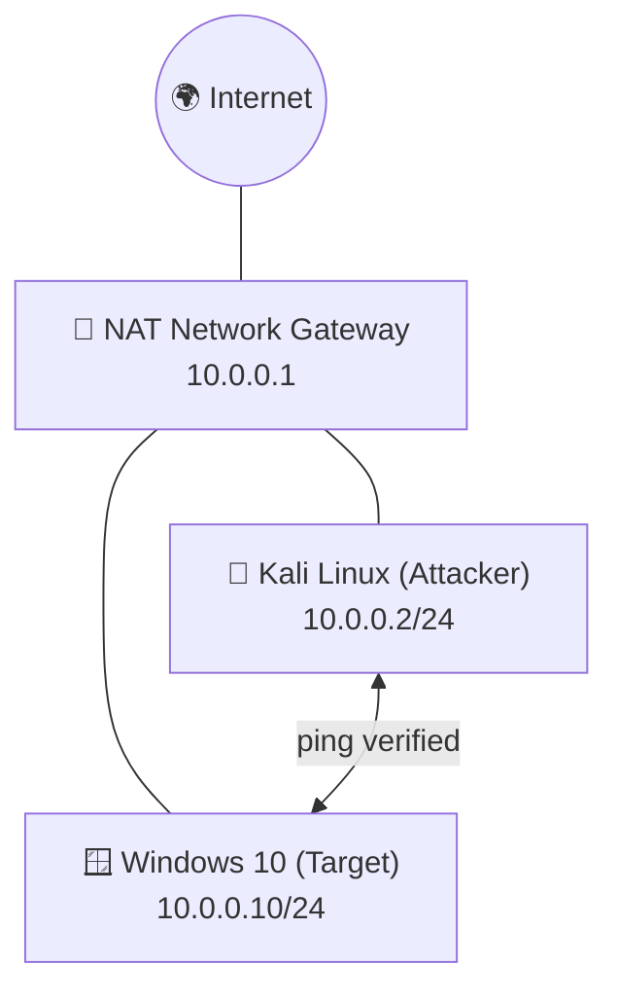

<div align="center">

# 🔐 Cybersecurity Lab Environment Setup

**Building an isolated Kali Linux + Windows 10 virtual lab for penetration testing and ethical hacking practice**
</div>

<p align="center">
  
  
  
  
  
  
  
  
  
  
</p>

---

## 📌 Project Overview

This project focuses on setting up a **virtual cybersecurity and penetration-testing laboratory** using VirtualBox, with **Kali Linux** as the attacker machine and **Windows 10** as the first target machine.

The purpose of the lab is to create a controlled environment where cybersecurity tools, network scanning, reconnaissance, vulnerability assessment, and other security-testing activities can be performed safely and repeatedly.

Both machines are connected to the same private virtual network, and two-way connectivity between them was verified with `ping`. More target machines can be added later.

---

## 🎯 Objectives

The main objectives of this project are to:

- Install and configure VirtualBox.
- Import Kali Linux as the attacker virtual machine.
- Create a Windows 10 virtual machine as a target.
- Create a private **NAT Network** for the cybersecurity lab.
- Assign a consistent static IP address to the Kali VM.
- Verify two-way connectivity between Kali and Windows.
- Take a clean VM snapshot for recovery.
- Document the complete setup process.
- Prepare the environment for future cybersecurity projects.

---

## 🛡️ Purpose of the Lab

The lab provides an isolated and controlled environment for cybersecurity learning and authorized security testing.

It can be used for activities such as:

- Network reconnaissance
- Port scanning
- Vulnerability assessment
- Packet analysis
- Web security testing
- Exploitation practice
- Security-tool experimentation

⚠️ **Important:** This laboratory must only be used for systems that you own or have explicit permission to test. Do not use the lab or its tools to attack unauthorized systems.

---

## 🏗️ Lab Architecture



Additional target machines can be added to the same virtual network in future projects.

---

## ⚙️ Lab Configuration

| 🧩 Component        | ⚙️ Configuration                    |
| ------------------- | ----------------------------------- |
| 🧰 Hypervisor       | Oracle VirtualBox                   |
| 🐉 Attacker OS      | Kali Linux 2026.2 (VirtualBox image)|
| 🪟 Target OS        | Windows 10                          |
| 🌐 Virtual Network  | NAT Network (`NatNetwork`)          |
| 📡 Network Address  | 10.0.0.0/24                         |
| 🐧 Kali IP Address  | 10.0.0.2/24 (static)                |
| 🪟 Windows IP       | 10.0.0.10/24                        |
| 🚪 Default Gateway  | 10.0.0.1                            |
| 🌍 DNS Server (Kali)| 8.8.8.8                             |
| 🔌 Adapter Type     | Intel PRO/1000 MT Desktop (82540EM) |
| 🔀 Promiscuous Mode | Allow All                           |

---

# 🪜 Lab Setup Procedure

## Step 1. Install VirtualBox

Oracle VirtualBox was installed as the hypervisor.

---

## Step 2. Create the NAT Network

A dedicated NAT Network named `NatNetwork` was created in VirtualBox with the `10.0.0.0/24` range.

A **NAT Network** was selected because multiple virtual machines attached to it can communicate with one another while also having outbound network connectivity.

This allows the attacker and target VMs to communicate inside the lab.

---

## Step 3. Import Kali Linux

The Kali Linux VirtualBox image (`kali-linux-2026.2-virtualbox-amd64`) was imported into VirtualBox.

The VM network adapter was configured as follows:

```text
Adapter 1
Attached to:      NAT Network
Network:          NatNetwork
Adapter Type:     Intel PRO/1000 MT Desktop (82540EM)
Promiscuous Mode: Allow All
Cable Connected:  Yes
```


---

## Step 4. Create the Windows 10 Target VM

A Windows 10 VM was created and attached to the **same** NAT Network with identical adapter settings. Each VM gets its own unique MAC address.

```text
Adapter 1
Attached to:      NAT Network
Network:          NatNetwork
Adapter Type:     Intel PRO/1000 MT Desktop (82540EM)
Promiscuous Mode: Allow All
Cable Connected:  Yes
```


---

## Step 5. Configure the Kali Linux Network

The Kali wired connection was edited in NetworkManager and set to **Manual** IPv4 addressing:

```text
IP Address: 10.0.0.2
Netmask:    24 (255.255.255.0)
Gateway:    10.0.0.1
DNS:        8.8.8.8
```

The option *"Require IPv4 addressing for this connection to complete"* was left unchecked.

A consistent IP address makes it easier to document the lab and reference the Kali machine in future exercises.


---

## Step 6. Create a Clean VM Snapshot

After completing the initial configuration, a VirtualBox snapshot should be taken of each VM.

Example snapshot name:

```text
Clean Lab - Network Setup
```

The snapshot represents the clean baseline of the laboratory. If a future exercise changes or damages a VM, it can be restored to this baseline.

---

# 🔎 Lab Verification

| ✅ Test                    | 🧾 Command / Source      | 🎯 Result                                      |
| ------------------------- | ------------------------ | ---------------------------------------------- |
| 🪟 Windows IP configuration | `ipconfig` (Windows)    | ✅ IPv4 `10.0.0.10`, mask `255.255.255.0`, gateway `10.0.0.1` |
| 🐉 Windows → Kali          | `ping 10.0.0.2`          | ✅ 4/4 replies, 0% loss, TTL=64                 |
| 🪟 Kali → Windows          | `ping 10.0.0.10`         | ✅ Continuous replies, TTL=128                  |
| 🌍 Windows → Internet      | `ping 8.8.8.8`           | ⚠️ 2 of 4 packets received (50% loss)           |

### Windows → Kali


### Kali → Windows


### Example Results

```text
Kali:     10.0.0.2/24     (Linux,   TTL=64)
Windows:  10.0.0.10/24    (Windows, TTL=128)
Gateway:  10.0.0.1
```

---

# 🐞 Problems Encountered & Solutions

Documenting problems is an important part of the project.

## Problem 1. Packet Loss to the Internet from Windows

When testing `ping 8.8.8.8` from the Windows VM, only 2 of 4 packets were returned (50% loss), even though communication with Kali was perfect (0% loss).

This shows the internal lab network works correctly, and the loss happens on the path *outside* the NAT Network (host connection / NAT translation).

Next steps to investigate:

1. Repeat the ping several times to see whether the loss is consistent or temporary.
2. Check the host machine's own Internet connection.
3. Confirm the Windows VM has the correct gateway (`10.0.0.1`) and DNS configured.

---

# 💡 What I Learned

Through this project, I learned how to create and configure a multi-machine virtual environment for cybersecurity practice.

The most important concepts I learned include:

### 1. NAT vs NAT Network

A standard NAT adapter isolates each VM from the others. A NAT Network lets multiple VMs on the same virtual network communicate with each other while still providing translation for outbound Internet access. This makes it the right choice for an attacker/target lab.

### 2. Virtual Machine Networking

Both VMs use the same adapter type and the same `NatNetwork`, but each has a unique MAC address and IP address. Matching the network name is what places them in the same subnet.

### 3. Static IP Configuration

I learned how to configure and verify IPv4 addressing, netmask, gateway, and DNS settings in Kali Linux using NetworkManager, and how to confirm the Windows side with `ipconfig`.

### 4. TTL Reveals the Operating System

The ping replies showed **TTL=64** from Kali and **TTL=128** from Windows. These are the default starting TTL values of Linux and Windows, so TTL gives a quick hint about the operating system of a target during reconnaissance.

### 5. VM Snapshots

A clean snapshot should be created **before performing risky or experimental activities**, giving a known-good recovery point.

### 6. Documentation

Documenting commands, configuration, screenshots, problems, and solutions is an important part of a professional cybersecurity project.

---

# 🔐 Security & Ethical Use

This laboratory is intended strictly for education purposes only.

---

# 🔗 Tools & Resources

- **VirtualBox:** [https://virtualbox.org/wiki/Downloads](https://virtualbox.org/wiki/Downloads)
- **Kali Linux:** [https://kali.org/get-kali](https://kali.org/get-kali)

---

# 👤 Author

**Starhang Limbu**\
Computer Engineering Student

LinkedIn: _add your link here_ · GitHub: _add your link here_

---

## 📌 Project Information

**Program Name:** Cybersecurity at Networkwalks | **Week:** 01 | **Project:** Cybersecurity & Pentesting Lab Setup | **Repository:** GitHub
